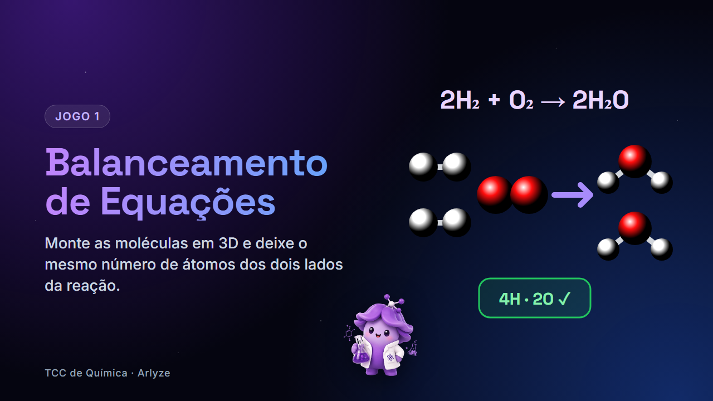

# Balanceamento de Equações Químicas




Jogo educativo de química, parte do TCC, em que o aluno **balanceia equações químicas** montando as moléculas em 3D. Foi inspirado na simulação [Balancing Chemical Equations do PhET Colorado](https://phet.colorado.edu/pt/simulations/balancing-chemical-equations) e segue a ideia da **Lei de Lavoisier**: nenhum átomo é criado nem destruído, só reorganizado.

A mascote **Arly** guia o aluno pelo tutorial.

## Funcionalidades

- **Tutorial interativo:** a Arly explica o jogo passo a passo. O fundo fica desfocado e só o elemento que ela aponta pode ser usado. O tutorial pode ser pulado a qualquer momento.
- **Moléculas 3D reais:** as coordenadas de cada molécula vêm da **API da PubChem** e as cores seguem o padrão CPK.
- **Interação por toque e mouse:**
  - arrastar uma fórmula para dentro da caixa adiciona uma molécula;
  - arrastar uma molécula para fora da caixa remove essa molécula;
  - arrastar o fundo da caixa gira as moléculas;
  - passar o mouse ou tocar numa molécula mostra o nome dela e os átomos que ela tem;
  - as setas ▲▼ também mudam os coeficientes.
- **Contagem de átomos:** um gráfico de barras compara os reagentes com os produtos.
- **3 níveis** (fácil, médio e difícil), cada um com **13 equações cadastradas** e **5 sorteadas** por partida, pontuação, cronômetro, estrelas e recorde salvo no navegador.
- Confete ao acertar.

## Como rodar

É preciso ter o **Python 3** instalado. Não é necessário instalar nenhuma biblioteca.

```bash
python server.py
```

Depois, abra **http://localhost:8000** no navegador.

> É preciso ter internet para carregar as moléculas da PubChem e as bibliotecas usadas pela página (Tailwind, Three.js e as fontes). Se a internet cair, o jogo continua funcionando, mas as moléculas aparecem como um agrupamento simples de bolinhas.

## Como jogar

1. Siga o tutorial da Arly, ou clique em **Pular tutorial**.
2. Escolha um **nível**.
3. Ajuste a quantidade de cada molécula até os dois lados terem o **mesmo número de cada átomo**.
4. Clique em **Verificar**. Acertar na 1ª tentativa vale **2 pontos** e na 2ª vale **1 ponto**.
5. Use sempre os **menores números inteiros** possíveis: 2 H₂ + O₂ → 2 H₂O, e não 4 H₂ + 2 O₂ → 4 H₂O.

## Tecnologias

| Tecnologia | Uso |
|---|---|
| **Python** (só a biblioteca padrão) | Servidor local que entrega os arquivos do jogo e consulta a PubChem, guardando as respostas em cache |
| **HTML + CSS + JavaScript** | Interface e lógica do jogo |
| **Tailwind CSS** (CDN) | Estilização |
| **Three.js** | Desenho das moléculas em 3D |
| **API PubChem (PUG REST)** | Fórmula, massa molar e coordenadas 3D/2D das moléculas |
| **Google Fonts** | Space Grotesk, Inter e Fira Code (mesma tipografia do site [Arlyze](https://arlyze.vercel.app/)) |

## Estrutura

```
├── server.py    # servidor + rota /api/molecule/<nome> (proxy da PubChem)
├── index.html   # layout da página e estilos
├── game.js      # lógica: equações, tutorial, jogo, desenho 3D e interações
└── arly.png     # mascote
```

## Como funciona por dentro

- **API própria:** `GET /api/molecule/<nome em inglês>` devolve `{ cid, formula, massa, tipo, atomos: [[símbolo, x, y, z], ...] }`. O servidor busca as coordenadas **3D** na PubChem. Quando a molécula não tem versão 3D, como metais e sais (Fe, NaCl...), ele usa as coordenadas **2D**.
- **Verificação:** o `game.js` conta os átomos de cada lado multiplicando pelos coeficientes. A resposta só é aceita se todos os átomos baterem e se o MDC dos coeficientes for 1, ou seja, se os números estiverem na forma mais simples.
- **Autoteste:** ao carregar, o `game.js` confere se todas as equações cadastradas estão balanceadas. Se alguma estiver errada, aparece um aviso no console do navegador (F12).

## Como adicionar uma equação

No `game.js`:

1. Adicione a equação já balanceada na lista do nível desejado em `NIVEIS`, por exemplo `'2 H2 + O2 -> 2 H2O'`.
2. Se ela usar alguma substância nova, cadastre essa substância em `NOMES` com o nome em português e o nome em inglês usado na busca da PubChem, por exemplo `H2O: ['água', 'water']`.

> As fórmulas precisam ser escritas sem parênteses. Por exemplo, Ca(OH)₂ deve ser escrito como `CaO2H2`. Os coeficientes vão até 10.

## Créditos

- Inspiração: [PhET Interactive Simulations](https://phet.colorado.edu), University of Colorado Boulder
- Dados moleculares: [PubChem](https://pubchem.ncbi.nlm.nih.gov), NIH
- Mascote Arly e identidade visual: equipe do TCC
